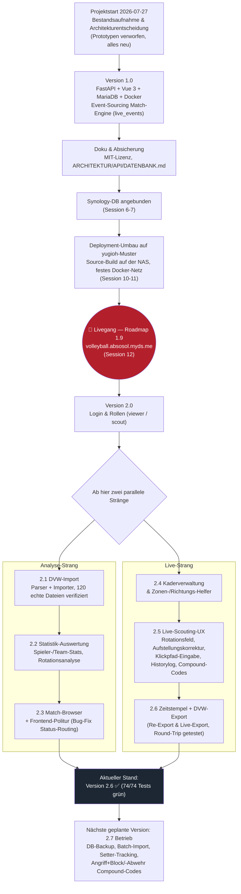

# Ablaufdiagramm (Gesamtübersicht Projektverlauf)

Stand: Version 2.6 (2026-08-09) — verdichtet aus `PROGRESS.md` (37 Session-Einträge),
siehe `docs/ROADMAP.md` für den vollständigen Versionsverlauf mit Details.

Zeigt den Gesamtablauf des Projekts von der ersten Bestandsaufnahme über den
Livegang auf der Synology bis zu den beiden parallel laufenden
Entwicklungssträngen (Analyse vs. Live-Scouting).

